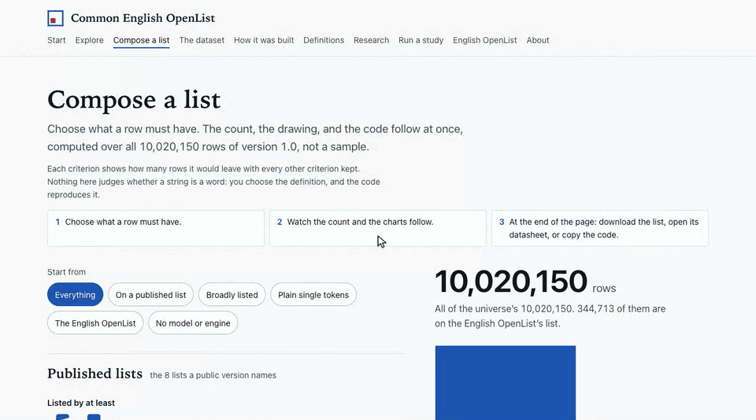

# CEOL Universe

The CEOL Universe is an inventory of candidate English strings, each with its provenance: where the string came from, and which reference sources list it. It is a frame from which a word list can be derived under a stated definition. A row is a candidate; the inventory makes no claim that a string is a word.

**The dataset is not published yet.** Version 1.0 is built, and its Hugging Face home will be [`ryanjosephkamp/ceol-universe`](https://huggingface.co/datasets/ryanjosephkamp/ceol-universe); that link, and the links to it in the documents, will work once it is released. This repository holds the code that builds the dataset, the site, the study kit, and the documents. The data itself is not in the repository.

*Compose a list, on the site: choose what a row must have, watch the count and the charts follow over every row, copy the code that reproduces the list, and open its datasheet. `tools/demo_gif.py` records this from the site.*

## Where to start

| To | Read |
|---|---|
| know what the dataset holds, how it was built, and what it leaves out | [the dataset card](pipeline/research/release/CARD_v1.0.md) |
| see every column | [docs/DATA_DICTIONARY.md](docs/DATA_DICTIONARY.md) |
| read the technical report | [pipeline/research/release/report/PAPER_v1.0.md](pipeline/research/release/report/PAPER_v1.0.md) |
| draw a reproducible sample and run a labeling study | [kit/README.md](kit/README.md) |
| see how the universe is kept over time | [docs/UPKEEP.md](docs/UPKEEP.md) |
| see each source's terms and what the dataset withholds | [the dataset card](pipeline/research/release/CARD_v1.0.md), sections 6 and 7 |
| see what the archival folder holds | [reference/README.md](reference/README.md) |
| see how the fixtures were built | [site/fixtures/README.md](site/fixtures/README.md), [kit/fixtures/README.md](kit/fixtures/README.md) |
| see how the site is built | [site/README.md](site/README.md) |

## Build and test

The code runs on Python 3.11 with the packages in `requirements.txt`.

    pip install -r requirements.txt
    make test      # the pipeline's tests and the kit's
    make figures   # every figure a document quotes, re-derived from the code
    make links     # every link in the documents

The build reads the dataset's layers from `data/` and checks them against lists in `private/`; neither is in the repository, and both are ignored by git. A checkout that has neither runs every test and check that needs no layers; the others are skipped or deferred, and each says so. `make site` builds the site (Node 22, pnpm).

## Licenses

- The code is under the MIT license (`LICENSE`).
- The dataset, the site's text, and the documents are under CC BY-SA 4.0 (`LICENSE-CC-BY-SA-4.0.txt`); the technical report is under CC BY 4.0.
- The dataset draws on third-party sources under their own terms. The license review (`docs/licenses/`) states them, and a NOTICES file ships with the dataset.

## Contact

Questions and corrections: [open an issue](https://github.com/ryanjosephkamp/ceol-universe/issues). To ask that a source or a row be withheld, corrected, or restored, write to ryanjosephkamp@gmail.com; a request is acknowledged within 7 days and acted on within 14 days of its verification (see `docs/UPKEEP.md`, section 7).
