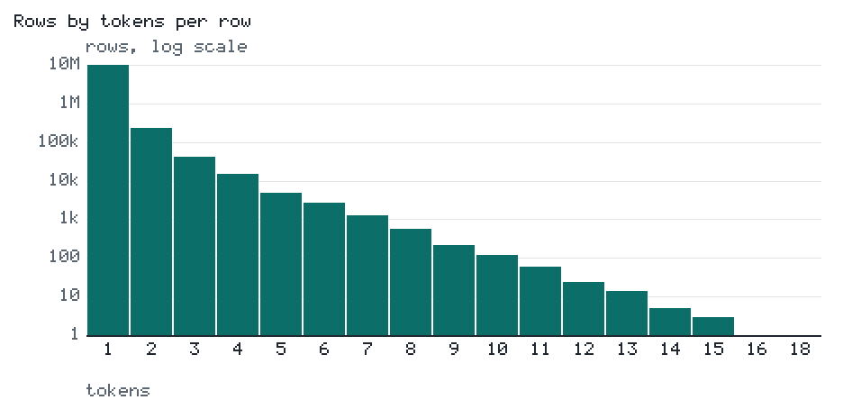
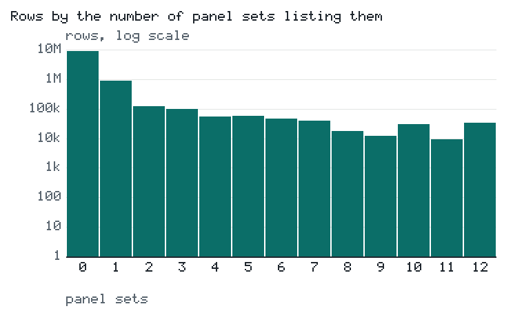
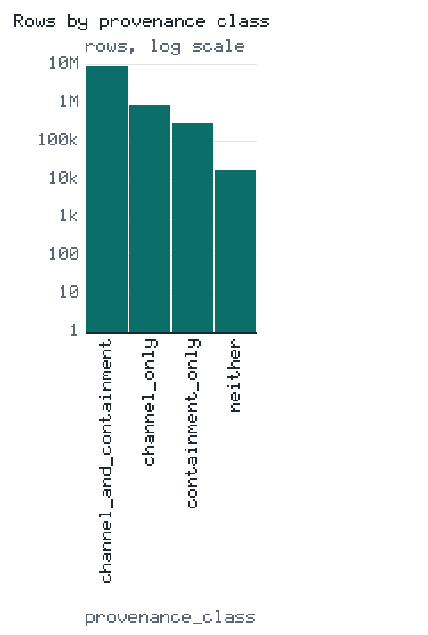

# The CEOL Universe: construction, contents, and limits of a candidate inventory of English

**An earlier skeleton of a technical report.** Not published; the published
technical report is `PAPER_v1.0.md`.

**The version of the figures:** `v2.0`, from `the release record research/release/release_v2.0.json, built 2026-09-26 over the pin of C-016`. The figures are those of a private rehearsal and regenerate at v3.0.

**Authors.** To be stated by the maintainer.

**The dataset.** `ryanjosephkamp/ceol-universe` on the Hugging Face hub, private at
this version.

**How the figures are held.** Every figure in this report is a row of
`research/release/report/report_calcs.py` or
`research/release/release_calcs.py`, rendered into this file from
`research/release/report/REPORT.template.md` and held to it by
`check_release_report` in `research/verify_doc_numbers.py`. Each row
names the decision entry and the committed record it reads. The
codes (C-001 and onward) are the decision entries of a private archive
repository; the record each row reads is committed here.

## Reader's index

| A reader's question | Where this report answers it |
|---|---|
| Why the universe exists, and for whom | §1 |
| What a row is, and what makes a string a row | §1, §2, §4 |
| How many rows there are, and of which kinds | the abstract, §5 |
| Which sources it draws on, under which licenses | §3 |
| How it was built, step by step, with records | §4 |
| What it holds, measured | §5 |
| What it does not hold, and where it is weak | §6, §7 |
| How it relates to the study that samples from it | §8 |
| How it is versioned, identified, and cited | §9 |
| How to reproduce it | §10 |

The mapping of these questions to the named documentation standards for
datasets waits for the literature pass, UL-1.

## Abstract

The CEOL Universe is the candidate inventory of the Common English
OpenList (CEOL), a project to build a list of valid common English words
that excludes exclusive proper nouns and exclusive acronyms and admits
hyphenated compounds, accented loanwords, contractions, apostrophe
forms, ligature and diaeresis spellings, and multiword terms under an
executable grammar. A row is a string that a pinned source lists as an
entry, that the English OpenList (EOL) had collected as a candidate, or
both. No row is validated: the universe records candidates and the
evidence about them, and validity is the business of operational
definitions applied to it later, each producing a separately named
dataset. Version `v2.0`, a private rehearsal of the release
pipeline, holds `10,294,621` rows. It is the shippable
projection of universe v2, the pin of C-016, whose `10,296,606`
candidates include `1,985` rows attested only by the
game lists NWL2023 and CSW21, which are not redistributable and never
ship. Of the release's rows, `294,865` are multiword,
`1,429,181` are listed by a panel set,
`330,386` were made by the EOL's lost generator and are
labeled so, and `16,373` have no recorded intake channel
and no measured containment. The first limitation leads its section:
`8,011,809` single-token rows are strings
inherited from the EOL that are Google Books 1-gram types and that no
panel set lists. Every row carries its intake provenance and its
containment in each pinned reference, and each single-token row carries
corpus and orthographic features. This report documents the grammar,
the sources and their licenses, the construction with a committed record
at each step, the measured profile, the limitations, and what the
universe does not record.

## 1. The mission and the datasets

The CEOL's mission, as its standing instructions state it in the wording
of C-015: "build the world's largest list of valid common English words
— excluding exclusive proper nouns and exclusive acronyms, including
almost every other term attested as a single lexical unit — internal
spaces admitted" (the original's emphasis removed). The universe is the
first stage of that mission and its evidence base. Presence in a pinned
source admits a string as a candidate; validation belongs to
measurement, and no source is the definition of valid (C-004:
"Dictionaries propose; measurement disposes."). A candidate is never
called valid at intake, and no threshold is chosen before a study
chooses it (the project's standing rule).

C-078 line 1 names the datasets:

- **The EOL** (`ryanjosephkamp/english-openlist`): the validated English
  word list under its own grammar and governance. The CEOL reads it at
  the pinned revision `c1139698` and never writes to it.
- **The CEOL Universe** (`ryanjosephkamp/ceol-universe`): the candidate
  inventory this report describes, versioned as its pins are (v2 the pin
  of C-016, v3 the pin of a later entry); a dataset of its own and not a
  config of the private working dataset
  `ryanjosephkamp/common-english-openlist`.
- **The validated subsets**, each named for an operational definition
  and its version, `ceol-<definition>-<version>`; the in-the-wild
  programme's first will be `ceol-itw-1` when it exists. Each is a
  separate dataset with its own card, released after the study that made
  it.

No dataset is called the CEOL alone: the CEOL is the family name and the
mission.

## 2. The grammar

Every string in the universe is the output of the CEOL grammar,
whose executable specification is `ceol/grammar.py`, with `GRAMMAR.md`
as its companion prose; where the prose and the code could disagree, the
code is the specification. The grammar and a trap test for each Unicode
hazard were written before any word list existed.

**The inventory.** `GRAMMAR.md` states it as "Lowercase output over a
**closed** charset — extended only by a decision-log entry, never by an
edit", and C-015 added the space: `the character inventory (C-001, C-015; ceol/grammar.py): 26 base letters a–z; 19 accented letters (à á â ä ç è é ê ë í î ï ñ ó ô ö ú û ü), 5 of them diaeresis letters; 2 ligatures (æ œ); 47 letters; the hyphen U+002D, the apostrophe U+0027, and the space U+0020; a 50-character charset; 2 declared canonicalizations (U+00A0 to U+0020, U+2019 to U+0027)`. Digits
and every character outside the inventory are rejected. The accent
inventory is closed on purpose: it covers the loanword classes attested
in English text and leaves out the rest of the donor alphabets, whose
wholesale import the loanword criterion forbids.

**The pipeline**, as `GRAMMAR.md` draws it:

```
NFC  →  U+2019 → U+0027, U+00A0 → U+0020  →  lower()  →  NFC again
     →  structural validation
```

NFC and not NFKC, because compatibility decomposition would turn
presentation ligatures into letter sequences no author typed.
The declared canonicalizations are the only folds, each carried by its
decision: "Every other look-alike — U+2018, U+02BC, backtick, U+00B4, the
dashes U+2010/U+2013/U+2014, the soft hyphen U+00AD, every other
whitespace character (tab, line breaks, the U+2000-block spaces, U+3000,
the zero-width characters) — is **rejected, not folded**. Folding an
undeclared character would invent data." lower() and not casefold(),
because casefold() maps the German sharp s to a double s and would turn a
donor-language spelling into an English-looking string, where lower()
leaves an undeclared letter in place to fail the charset check; the CEOL
diverges from the EOL here on purpose. NFC again, because
lower() can decompose a letter into a base and a combining mark, which
must then fail the charset check rather than pass it.

**The structural rules** (C-001; applied per token since C-015, ruled at
the S4 gate and recorded in C-016):

- every character in the declared charset;
- spaces single and interior only: "no leading, no trailing, no doubling
  — every space-separated token is non-empty, and each token must
  satisfy the single-token rules below";
- every token carries a letter;
- hyphens interior only: no leading, trailing, or doubled hyphen, and
  every hyphen-separated segment non-empty and carrying a letter;
- "Apostrophes interior or leading (per token), never a token's final
  character, never doubled."

A trailing apostrophe, the shape of the plural possessive, is not
admitted pending the possessive gate; admitting it would
be a recorded grammar extension and not a relaxation. The underscore "is
never a character: it decodes to space at the parse layer of any source
that documents underscore-as-space — today MediaWiki titles and WordNet
lemma fields — before the grammar sees the string". For a string
without a space the rules are the grammar as it stood before C-015, and
`tests/test_no_space_projection.py` proves the no-space projection
byte-identical over the full pinned universe.

**The class flags.** `ceol.grammar.classes()` computes non-exclusive
flags: the census's `6` exception classes,
which are hyphenated (a hyphen), accented (an accented letter other than
a diaeresis letter), diaeresis (a diaeresis letter), ligature (a
ligature), apostrophe-form (an apostrophe), and contraction (an
apostrophe-form with a token that ends in the negative clitic or a
declared enclitic, or that begins with an apostrophe); the spaced class
(a space; C-015); and the s-final diagnostic, a token ending in an
apostrophe and s, counted separately from the contractions because a
surface form cannot tell a possessive from a clitic. A medial
elision counts as apostrophe-form and not as contraction. Flags
compose, and a row with none is plain; the release writes that value
explicitly in `class_explicit`.

## 3. The sources, their licenses, and the licence split

The pinned sources are the EOL's evidence panel, taken over whole and
kept unchanged by ruling (C-016, its J4), with web2a added by the CEOL's
census and promoted to a detector at C-010. Their roles differ: a binary
detector lists a string or does not; SCOWL is an ordinal tier covariate;
the all-language Wiktionary title list is a screen; wordfreq and the
Google Books 1-grams are corpora whose values are features and which
never admit a member (the EOL's D-030, carried by C-009 and C-010). The
release carries `14` evidence columns: the
`12` binary detectors, the SCOWL tier, and the
title screen. The `13` panel sets
of the provenance layer are the detectors and the tier.

Each source with the license the EOL manifest's licence field records
for it, as the release records the field:

| Source (manifest id) | License as recorded | Role | What the release carries |
|---|---|---|---|
| `wordnet`, WordNet 3.0 as distributed with nltk | WordNet-3.0 | binary detector; lists spaced rows | `wordnet`; the spaced rows' listing; `wn_instance`, `wn_capitalized` |
| `wiktionary_english`, the Wiktionary pages with an English section | CC-BY-SA-4.0 | binary detector; lists spaced rows | `wiktionary_english`; the spaced rows' listing; `wk_proper_noun`, `wk_flags` |
| `wiktionary_titles`, every lowercase title in all languages | CC-BY-SA-4.0 | screen | `wikt_title_screen`, `wikt_title_any` |
| `web2`, Webster's Second International (1934), the system word list | public domain (1934) | binary detector | `web2` |
| web2a, the supplemental list of hyphenated terms beside web2 | none recorded | binary detector | `web2a` |
| `hunspell_en_US`, `hunspell_en_GB`, `hunspell_en_CA`, `hunspell_en_AU`, the LibreOffice dictionaries | LGPL-2.1-or-later OR MPL-1.1 | binary detectors | the hunspell columns; the variety proxies |
| `enable1`, the ENABLE word list | public domain | binary detector | `enable1` |
| `sowpods_legacy`, a legacy SOWPODS mirror | freely mirrored | binary detector | `sowpods_legacy` |
| `nwl2023`, NASPA Word List 2023 | proprietary (NASPA); not redistributable | binary detector | `nwl2023`, on shippable rows only |
| `csw21`, Collins Scrabble Words 2021 | proprietary (Collins); not redistributable | binary detector | `csw21`, on shippable rows only |
| `scowl`, SCOWL, the archive of 2020-12-07 | permissive (SCOWL) | tier covariate | `scowl_tier` |
| `wordfreq`, the wordfreq package | MIT | corpus feature | `wordfreq_zipf`, `wordfreq_scored` |
| `google_books_1gram_eng_2020`, the Google Books English 1-grams | CC-BY-3.0 | corpus feature | the Google Books feature columns, `zipf_log10_rank`, `zipf_resid`, `gb_type` |
| The EOL universe at revision `c1139698` | MIT, as the EOL's card template declares | the inherited strings | the inherited rows; `eol`, `eol_universe`; the EOL's intake channels |

The license strings are the manifest's own, and the notes to them are
the records'. web2a carries no license field in any record; its system
README reports the copyright of web2 lapsed "according to the supplier",
which is a statement and not a license, and C-079 line 2(e) accepted
that reading for the column to ship. The SOWPODS entry's "freely
mirrored" is a description and not a license, and the manifest derives
the list from CSW21. The installed wordfreq package
declares Apache-2.0 for its code and CC-BY-SA 4.0 for its data files,
and its README distributes the SUBTLEX word lists on the conditions that
their authors are credited and that it remain clear that SUBTLEX is
freely available data. A
comment beside the Google Books entry's redistributable field reads
"aggregates only; raw shards deleted", and the release carries
per-string aggregates only, no per-year row and no raw shard. None of this is legal advice; it records what
the pinned records state.

Of the sources, WordNet, Wiktionary, and the Google Books corpus have
published accounts the repository holds.
Princeton WordNet has had a single update since WordNet 3.0 was released
in 2006, and its open-source continuation is English WordNet
[@mccrae2019_english_wordnet]; the pin is WordNet 3.0. Wiktionary is a
freely available, collaboratively constructed online dictionary whose
coverage has been compared with expert-built lexicons
[@meyer2012_wiktionary_rival]. The Google Books Ngram corpus is the
corpus of digitized books introduced by Michel and colleagues
[@michel2011_culturomics]; the feature layer reads its English 1-grams
of the 2020 release.

The CEOL Universe is licensed CC-BY-SA 4.0, the share-alike floor of its
Wiktionary-derived rows and columns. The EOL's site
states that the EOL dataset is MIT-licensed; reconciling that statement
with the EOL's own card is the EOL's.

**The licence split**. NWL2023 and CSW21 carry
`redistributable = false` in the EOL manifest. The rows attested only by those lists,
`1,985` of the pin, are measured locally and never
committed, pushed, or published; every artifact that holds them stays
gitignored, and every release file is built without them, the build
asserting that none of their words reaches any file:
`the assertions on the written files (2026-09-26): restricted words checked 1,985, hits 0 in each of 6 files; distinct ids 10,294,621 of 10,294,621; spaced rows null in 17 columns: 294,865; columns 45; controls checked 20, ledger words outside the pin checked 17,113, hits 0; the release layer re-derived on 10,294,621 rows; each filter config equal to its predicate's filter`. These rows are candidates of the pin
and are in no version or channel of the CEOL Universe.

The per-row columns of those lists are a separate question. The private
rehearsal carries the `nwl2023` and `csw21` columns on its shippable
rows, as the private working dataset already did, and
the labels naming the lists in `sources`, `intake_channels`, and
`panel_sets`: `the game lists' columns and labels C-079 line 2 rules on for the public flip, as v2.0 carries them (profile.json, evidence.json): nwl2023 marks 195,875 rows of the release and lists 196,601 rows of the pin (99.63%); csw21 marks 277,524 rows of the release and lists 279,077 rows of the pin (99.44%); sowpods_legacy marks 267,751 rows of the release and lists 267,751 rows of the pin (100.00%); the labels eol:nwl2023 on 8,120, eol:csw21 on 84,511, eol:sowpods_legacy on 84,334 rows in sources, and audit:nwl2023 on 8,120, audit:csw21 on 84,511, audit:sowpods_legacy on 84,334 rows in intake_channels`. The EOL manifest's notes on those
lists say that their per-source rates are published and their raw
per-word columns are not (quoted in C-079 line 2(a)). C-079 line 2
therefore rules, for the entry that flips v3.0 public: the `nwl2023` and
`csw21` columns and every label naming them are withheld at v3.0, the
rows themselves shipping; SOWPODS is treated the same unless the
literature pass records a license for the mirror before the flip, when
the clause is re-ruled; `panel_sets`, `panel_count`,
and `provenance_class` are recomputed over the published panel, the card
says so, and the change log records the column and semantic changes
between v2.0 and v3.0; a NOTICES file generated by the
pipeline from the pinned artifacts ships beside the card with SCOWL's
copyright and permission notice, the WordNet 3.0 license, the hunspell
dictionaries' notice, the EOL's notice, and the wordfreq and SUBTLEX
credits with both SUBTLEX conditions, and the card's credits section
names the file; and the dataset's history on the hub
is squashed before its visibility changes, so that no reachable revision
carries v2.0's files or a withheld column, the flip entry recording the
revisions that existed before the squash. The counts
of v3.0's withholding are measured at that build and are not stated here. The SUBTLEX page the wordfreq README
names returned a not-found response under both schemes on 2026-09-26;
v2.0's card stands, and at v3.0 the credit names that page as the page
the README gives, with its retrieval outcome and date, and the NOTICES
file carries the README's own SUBTLEX statement; a current page that the
literature pass or the maintainer finds before the flip replaces it (C-080
line 3).

## 4. The construction, chapter by chapter

The universe was built in steps, each closed by a ruling of the maintainer's
and each with a committed report and record; the figures below are
those records'. Every step built a candidate inventory, and no step
called a string valid.

### 4.1 The census (C1; C-005)

The census re-read the EOL's pinned artifacts under the CEOL grammar,
"same bytes, wider rule" (`research/census/CENSUS.md`), and inventoried
the exception classes that the EOL's letters-only rule could not hold.
Its re-ingest reproduced the EOL's pinned tripwires, which `CENSUS.md`
tabulates beside the census's values, and widened the English entries:
`the census's re-ingest (CENSUS.md; census.json): the EOL's tripwires, 10,780,017 Wiktionary pages scanned, 775,869 English entries of plain letters, 4,416,747 lowercase titles of plain letters in all languages, and 234,454 web2 keys of plain letters; under the CEOL grammar 831,973 English Wiktionary entries`. It found `213,867` distinct
exception candidates: `the C1 census by class (C-005; census.json): hyphenated 80,441, apostrophe-form 128,242 (of which s-final 125,281), accented 4,719, ligature 1,940, diaeresis 1,504, contraction 1,281; from 9 sources and the seeds re-ruled from the EOL's deletion ledger (170 accepted, 20 rejected by the grammar); 151,774 (71.0%) in exactly 1 source`. The all-language title list
is a screen and is left out of the inventory, because a hit there means
only that some language uses the spelling (`CENSUS.md`). The maintainer
confirmed the classes at the C1 gate. Records:
`research/census/census.json`, `research/census/candidates.csv`,
`research/census/run_census.py`.

### 4.2 The merge and the filter-equivalence proof (C2; C-002)

The merge joined the EOL universe at the pinned revision,
`9,653,999` strings, and the census's candidates into
merged v0, `9,867,866` rows: `the merge (C-002; merge.json): of the inherited strings 345,103 in the EOL's valid list and 9,308,896 in its invalid list at revision c1139698; 213,867 census candidates; 0 strings in both; filtering by the eol column regenerates merged_valid_words.txt (aa8df4c5…) and merged_invalid_words.txt (23701bd8…), each equal to its pin`. The `eol`
column records the pinned split as a historical fact and never as a
verdict of the CEOL's; the EOL's nightly moves its live split, and the
CEOL compares against the pin (`research/merge/MERGE.md`). The
filter-equivalence proof is sha256 equality, which catches a missing
string, an extra string, and a duplicate at once, and it is a permanent
member of the test suite (`tests/test_equivalence.py`). The inherited
rows carry the dataset-level tag `eol_universe@c1139698` in `sources`,
because their per-source listing is what the evidence matrix measures. Records: `research/merge/merge.json`,
`research/merge/build_merge.py`.

### 4.3 The audit (C3)

The audit asked whether merged v0 was sufficiently complete under the
CEOL grammar, with instruments for per-source coverage, a fresh-source
residual, and a structural-plausibility frontier
(`research/audit/AUDIT.md`). The coverage: `the per-source coverage of merged v0 (C3; audit.json, reconcile.json): from 68.5% (eol:sowpods_legacy) and 69.16% (eol:csw21) to 100.0% (web2a), wiktionary_english 87.4% over 14 sources; exception-class misses 0; the miss union 140,974 (138,989 attested by a redistributable source, 1,985 only by NWL2023 or CSW21): 133,842 of the EOL's 133,842 frame additions, 7,099 wordfreq-only, and 33 SCOWL-visibility words`. The
decomposition of the miss union reconciles to a remainder of
`0` (`research/audit/reconcile.json`). The
residual: `the fresh-Wiktionary residual (C3; audit.json): over the 16 days from the dump boundary to the retrieval, 87,376 new pages, 45,239 with grammar-valid lowercase titles not in the universe, 10 English in a sha256-ranked sample of 1,000; a residual estimate of 452 English words (95% CI 246 to 828)`. It counts pages created after the dump, and a
page that existed at the dump and gained an English section later is not
counted (`AUDIT.md`). The frontier: `the structural-plausibility frontier (C3; audit.json): a char n-gram, orders 1-5, Witten-Bell, trained on valid@c1139698 (a-z only, v0); of its top 9,999 non-empty completions 9,237 (92.4%) already in the universe and 762 unattested`. The report states
its stopping rule: `the stopping rule (C3; AUDIT.md): every curated reference at least 99% covered by the pinned universe with every miss listed and attributed; the fresh-source residual under about 10,000 English words; a standing channel for words no reference holds`. The coverage clause failed by
construction while the additions stood outside the universe, admitting
them being left to the pin of the next step, and the residual clause
passed (`AUDIT.md`). Records:
`research/audit/audit.json`, `research/audit/reconcile.json`,
`research/audit/run_audit.py`.

### 4.4 The v1 pin

C-009 pinned the measurement universe at `10,001,741` candidates,
merged v0 and `133,875` additions, evidenced string for
string from the audit's miss lists: `the C-009 pin's parts (universe.json; reconcile.json): merged v0 9,867,866 rows, and the additions: the EOL's 133,842 frame additions and 33 SCOWL-visibility words; 1,985 restricted rows, attested only by NWL2023 or CSW21; 7,099 wordfreq-only strings held at the corpus boundary`. The corpus
boundary is part of the pin: corpus sources contribute features and
never members, and admitting a string that only a corpus attests would
take a superseding decision. The fresh-source residual is left to
the open intake, and nothing enters by estimate. The pin carries
the licence rule of §3 and lives in a committed layer, the shippable miss
list, and a gitignored local completion that holds the restricted rows.
Records: `research/universe/universe.json`,
`research/audit/universe_miss_candidates.csv`.

### 4.5 The spaced admission and the v2 pin

C-015 admitted terms with internal spaces: the space became a declared
character, intake stayed listedness-based (a pinned source lists the
string as an entry), and the boundary between a lexical unit and a
syntactic combination was assigned to the definition problem,
which the in-the-wild programme took over. The no-space projection of the extended grammar
was proven byte-identical to the earlier grammar before the space census
ran. The space census measured the multiword-capable sources:
`the space census (C-015; space_census.json, spaced_applicability.json): WordNet 63,483 spaced entries and Wiktionary 250,893, 19,511 in both, 43,972 in WordNet only, 231,382 in Wiktionary only, 294,865 in all; 229,297 (77.8%) with 2 tokens and at most 18 tokens; lengths p50 14, p90 21, p99 33 characters`. At the S4 gate the maintainer admitted the full union with
no category, properness, length, or part-membership filter; the
properness signals and the category flags are recorded as columns and
never used to filter, and a null means not measured by that source. C-016 pinned universe v2 at `10,296,606` rows with the
`294,865` spaced candidates admitted: `the C-016 pin (universe_v2.json): 10,296,606 rows, the v1 universe of 10,001,741 and the spaced admission (WordNet only 43,972, Wiktionary only 231,382, both 19,511); restricted rows 1,985, unchanged from v1; the eol and eol_universe projections each equal to its pin; the single-token projection over the v1 columns equal to v1's canonical content (18733e97…)`.
Both filter-equivalence proofs are permanent members of the test suite
(`tests/test_universe_v2.py`). The spaced class's evidence follows the
rule of C-010, measured: `the spaced class's detectors (C-016; spaced_applicability.json): 2 applicable (wiktionary_english 250,893, wordnet 63,483) and 11 structurally not applicable, each zero measured (csw21, enable1, hunspell_en_AU, hunspell_en_CA, hunspell_en_GB, hunspell_en_US, nwl2023, scowl, sowpods_legacy, web2, web2a)`. Records:
`research/space_census/space_census.json`,
`research/space_census/SPACE_CENSUS.md`,
`research/space_census/S4_GATE.md`,
`research/universe_v2/universe_v2.json`,
`research/universe_v2/spaced_applicability.json`.

### 4.6 The evidence matrix

The evidence matrix records, for every single-token candidate and every
detector, a lookup by exact equality of CEOL-normalized keys with nothing
folded. A cell is listed, not listed, or not applicable, and not
applicable means structural blindness: the detector could not have
listed the string whatever its merits, because the string's class lies
outside what the source's format or editorial scope can emit; a cell is
not applicable exactly where the detector's derived set holds no string
of the class and an account of that absence is recorded.
Treating blindness as a negative would hand every exception string false
negatives from sources that never could have listed it. The
matrix: `the evidence matrix over the v1 universe (C-010; evidence.json): 10,001,741 rows; listed by wiktionary_english 831,973; csw21 279,077; sowpods_legacy 267,751; hunspell_en_GB 262,413; web2 234,456; nwl2023 196,601; enable1 172,823; hunspell_en_AU 121,490; hunspell_en_US 121,252; hunspell_en_CA 120,947; wordnet 81,029; web2a 31,213; the SCOWL tier on 518,438 strings; the title screen on 1,504,118 rows`. The blind cells: `the structurally blind cells of the evidence matrix (C-010; evidence.json): wiktionary_english 0; csw21 213,867; sowpods_legacy 213,867; hunspell_en_GB 1,940; web2 135,680; nwl2023 213,867; enable1 213,867; hunspell_en_AU 88,348; hunspell_en_US 88,348; hunspell_en_CA 88,348; wordnet 8,147; web2a 9,923,554; 545 distinct binary patterns; 88.64% of rows listed by no panel set, the SCOWL tier included (SR2, reading A)`. The
matrix reproduces the EOL's: `the reproduction of the EOL's evidence matrix (C-010; evidence.json, reconcile.json): 11 of 11 shared detectors equal to the EOL's totals digit for digit on its frame of 9,787,841 strings; SCOWL wider by 3,051 strings under the census's inclusion rule (438,987 against 435,936)`. The accounts
behind the blind cells: the game lists are competition lexica over the
tile alphabet and hold no hyphen, apostrophe, or accent; the lemma
inventory of WordNet 3.0 is ASCII; web2 is the ASCII system word list;
the hunspell dictionaries en_US, en_CA, and en_AU expand to apostrophe
and contraction forms only, and en_GB alone carries hyphens, accents,
and diaereses; SCOWL's included files carry accents and neither a
hyphenated entry nor a ligature; web2a holds hyphenated compounds only
and is not applicable to plain strings. Records:
`research/evidence/evidence.json`, `research/evidence/EVIDENCE.md`.

### 4.7 The feature layer

The feature layer holds, for every single-token candidate, channels
whose reliability is unknown and which never decide membership:
orthotactic log-probabilities under a character model over the full
alphabet, the typed OCR-confusion ratios, a measure of morphological
productivity, the Google Books aggregates with a Zipf-Mandelbrot
residual, and wordfreq's Zipf frequency. The corpora:
`the feature layer's corpora (C-011; features.json): 15,628,267 Google Books types in the CEOL re-stream of the 2020 English 1-grams; wordfreq Zipf values for 303,511 strings of wordfreq's own list; the Zipf-Mandelbrot fit's alpha 1.5573`. The character model: `the character model (C-011; features.json, features_gate.json): 127,043 strong positives by the pool rule (87,178 under the strict variant), train 89,059, dev 12,595, test 25,389; held-out perplexity accented 13.446 (bound 25.0), apostrophe-form 5.684 (bound 25.0), hyphenated 10.628 (bound 25.0), ligature 7.511 (bound 25.0), plain 7.148 (bound 9.0); 0 classes on the not-applicable fallback`. The gates:
`the feature layer's gates (C-011; features_gate.json): 3 of 5 OCR-confusion families admitted (apostrophe_loss, hyphen_drop, ligature_expansion), 2 rejected (diacritic_strip, hyphen_junction); SR2 reading B 845,162 rows, 8.45% against a bar of 50%, passed`. Every bound and every gate was declared before the
features were built. The release ships the layer's
`21` columns as the `features` config,
`9,999,756` rows keyed by `id` and `word`, and keeps the
rejected families' columns, flagged inadmissible
(`research/release/columns.py`). Records:
`research/features/features.json`, `research/features/features_gate.json`,
`research/features/FEATURES.md`.

### 4.8 The intake-provenance layer

The residual first. `16,373` of the pin's
`10,296,606` candidates have no recorded intake channel and no
measured containment: `the residual over the pin (C-064, C-065; provenance.json): 0.16% of the pin's rows; 16,371 in the EOL's invalid layer (0.18% of that layer) and 2 in its valid layer; 16,367 with an entry in the invalid dictionary and 2 in the valid dictionary, each recording no channel, and 4 with no dictionary entry; 288 of them page titles in some language's Wiktionary, a screen and not containment`. That count rests on
a reading the maintainer ruled: the EOL's demotion ledgers name the forms the
EOL demoted as synthetic, and the layer labels those forms generated;
without the reading the residual would be
`46,185`. Among the
release's rows the residual is `16,373`
(`0.16%`).

The layer records provenance in separate senses kept in separate
columns. The intake channel is the route by which a string first
entered the candidate pool: for an inherited string it is read from the
EOL's dictionaries at the pinned revision, whose discovery log records
where a string was first seen and is never evidence (the EOL's decision
D-003, repeated by C-008); for the CEOL's own layers it is the pin's
`sources` column. The measured containment is the string's listing in
the panel sets and its presence in the corpora. The inputs:
`the EOL's dictionaries at revision c1139698 (C-064 ruling 2; C-065 ruling 3; provenance.json): the valid dictionary 282,080,828 bytes, 345,103 entries (sha256 20e5baed…); the invalid dictionary 12,237,976,092 bytes, streamed once and never stored, 9,275,414 entries parsed over 9,275,416 lines (sha256 8ccfccdf…)`. Every row falls in a single provenance class and a
single intake kind: `the provenance classes over the pin (C-064; provenance.json): channel_and_containment 9,164,209 (89.00%), channel_only 828,789 (8.05%), containment_only 287,235 (2.79%); the kinds: obtained 9,323,613, derived 642,607, generated 330,386 (3.21%); the layers: c1_exceptions 213,867; c4_additions 133,875; eol_invalid 9,308,896; eol_valid 345,103; spaced_c015 294,865`. A recorded channel is not
an attestation: `the discovery log against containment (C-008, C-064; provenance.json): the label wordnet on 3,443 rows of the EOL's valid list (2,127 at the valid tier) where the WordNet panel set lists 57,970; the label google_ngrams on 8,060,854 inherited rows, 0 of them not a Google Books type, while 590,891 further inherited Google Books types lack the label`. A missing channel is not a
missing origin: `the strings with no recorded channel (C-064; provenance.json): 303,608 inherited strings carry eol:phase1-unrecorded; 8,456 of them listed by a panel set, 286,120 Google Books 1-gram types (278,715 of those listed by no panel set), 64 more scored by wordfreq alone, and 16,373 with no containment; 96.86% of the inherited strings have a recorded channel`.

The generated strings: `the generated strings (C-064 rulings 3 and 11; C-065 ruling 2; provenance.json): the record of generation in 31,243 entries of the valid dictionary, 265,549 of the invalid dictionary, and 33,594 strings that only the EOL's demotion ledgers name; 97.01% with no measured containment; 0 with a discovery-log label; the engine inferred from the form: affixation 327,389, chemical-variation 1,594, greek-plural 954, medical-scientific-prefixing 338, unresolved 111 (99.09% affixation); the inferred rule agreeing with the form the ledger claims on 33,594 of 33,594 ledger rows`. Every generated string
stays a candidate. The generator's code is
lost, and the method is recorded as an inference from
the surviving forms and the EOL's history, confirmed by the maintainer
without amendment: blind affixation over the then-valid list with no
part-of-speech filter, chemical substituent variation and short
root-infix-suffix chains, medical and scientific prefixing, Greek
plurals, and a domain label for each base; the tools are the maintainer's
recollection and not a record. The engine of each row
is inferred from its form alone and named as inferred
(`research/provenance/synthetic_engine.py`; C-065 ruling 4). The maintainer's
statement that the EOL's strings relied largely on the Google Books
1-gram types is recorded as the maintainer's statement: containment shows that
a corpus holds a string, not that the EOL took the string from it (C-064
ruling 6; `research/provenance/PROVENANCE.md` §6). Records:
`research/provenance/provenance.json`,
`research/provenance/PROVENANCE.md`,
`research/provenance/eol_dictionaries_manifest.json`.

## 5. The profile

The profile is the release's profile page quoted by its rows:
`research/release/profile/universe_profile.py` computes
`research/release/profile/profile.json` and the plots from the release
files alone, and `research/release/profile/pos_estimate.py` computes the
part-of-speech estimate from the release files and WordNet 3.0 as
installed under nltk: `the profile of v2.0: 15 plots, 10,294,621 rows profiled, 144,512 WordNet-listed rows in the part-of-speech estimate, WordNet 3.0`. The figures describe
version `v2.0`.

**The rows and the configs.** Version `v2.0` holds
`10,294,621` rows in the `universe` config and
`9,999,756` in `features`. Its `4`
filter configs are filters of `universe` by stated predicates, asserted
on the written files: `1,429,181` panel-listed rows
(`13.88%`), `345,103` rows of the
EOL's valid list at the pin, `294,865` spaced rows, and
`236,484` rows with an exception class. The `universe`
config carries `45` columns in
`5` blocks (the key, the pin's columns, the release
layer, the provenance layer, and the evidence matrix), and `features`
carries `23`. The meaning and the null semantics
of every column are stated once, in `research/release/columns.py`, from
which the card's tables are rendered.

**Tokens, characters, and lengths.** `the rows of v2.0 by tokens (profile.json): 1 token 9,999,756; 2 tokens 229,297; 3 tokens 40,856; 4 tokens 14,922; 5 tokens 4,875; 6 tokens 2,637; 7 tokens 1,274; 8 tokens 564; 9 tokens 215; 10 tokens 119; 11 tokens 58; 12 tokens 24; 13 tokens 14; 14 tokens 5; 15 tokens 3; 16 tokens 1; 18 tokens 1; the EOL's valid list 345,103 rows of 1 token and 0 of more`.
`the characters of v2.0's rows (profile.json): letters a–z only 9,785,889; an apostrophe 140,851; a hyphen 90,022; a space 294,865; an accented letter 6,763; a ligature 2,002`. `the lengths of v2.0's rows in characters (profile.json): minimum 1, p5 5, p25 7, median 9, p75 11, p95 15, p99 20, maximum 100; mean 9.11`.



**Classes.** `the class flags of v2.0's rows (profile.json): spaced 294,865; apostrophe-form 140,851; s-final 137,018; hyphenated 90,022; accented 5,245; ligature 2,002; contraction 1,841; diaeresis 1,530; rows by the number of flags: 0 9,785,889; 1 359,064; 2 134,841; 3 14,680; 4 147`.

**Listing.** `the rows of v2.0 by the number of panel sets listing them, with the EOL's valid list among them (profile.json): 0 sets 8,865,440 (76,944); 1 set 906,951 (58,457); 2 sets 124,606 (10,877); 3 sets 98,252 (15,165); 4 sets 55,916 (4,778); 5 sets 57,649 (8,216); 6 sets 45,249 (36,152); 7 sets 38,817 (35,172); 8 sets 17,630 (16,413); 9 sets 11,950 (11,200); 10 sets 29,910 (29,604); 11 sets 9,183 (9,070); 12 sets 33,068 (33,055)`. `the single-token rows of v2.0 each panel set lists (profile.json): wiktionary_english 831,973; scowl 518,438; csw21 277,524; sowpods_legacy 267,751; hunspell_en_GB 262,413; web2 234,456; nwl2023 195,875; enable1 172,823; hunspell_en_AU 121,490; hunspell_en_US 121,252; hunspell_en_CA 120,947; wordnet 81,029; web2a 31,213`.
`the evidence columns' values in v2.0 (C-010; profile.json): each detector column -1, 0, 1 (1 listed, 0 not listed, -1 structurally blind to the row's class); scowl_tier -1, 0 and the tiers 10 to 95; wikt_title_screen 0, 1; each null on 294,865 spaced rows`.



**Intake.** `the rows of v2.0 by intake (profile.json): by date 2026-08-17 9,653,999; 2026-08-20 345,757; 2026-08-26 294,865; by layer c1_exceptions 213,867; c4_additions 131,890; eol_invalid 9,308,896; eol_valid 345,103; spaced_c015 294,865; by kind obtained 9,323,613, derived 640,622; by class channel_and_containment 9,162,224, containment_only 287,235`. Of the same rows,
`330,386` are generated (`3.21%`),
`828,789` have a recorded channel and no measured
containment, and `16,373` have neither (§4.8).



**Properness, flags, and varieties.** `the properness signals and flags of v2.0 (C-016; profile.json): wn_instance true 7,812, false 55,671, null 10,231,138; wn_capitalized true 24,635, false 38,848, null 10,231,138; wk_proper_noun true 582, false 250,311, null 10,043,728; wk_flags idiomatic 8,548; phrasal-verb 19,481; phrasebook 262; proverb 1,186`.
`the variety proxies of v2.0 (profile.json): variety_gb_not_us true 146,322; variety_us_not_gb true 14,308; null on 383,213 rows each`. The variety proxies mark a difference between the
British and the American hunspell dictionaries and are not variety
labels.

**Corpora.** `the corpus and screen columns of v2.0 (profile.json): gb_type false 1,236,010; wordfreq_scored false 9,696,245; wikt_title_any true 1,504,090; each null on the 294,865 spaced rows`. `8,763,746` rows are
Google Books 1-gram types, and wordfreq scores
`303,511`.

**Part of speech.** The universe records no part of speech at this
version (§7). An estimate of the coverage WordNet could give:
`144,512` rows are WordNet-listed, and
`the part-of-speech coverage estimate of v2.0 (pos_estimate.json): WordNet 3.0 lists 81,029 single-token rows and 63,483 spaced rows; with a noun sense 116,140, verb sense 16,028, adjective sense 20,537, adverb sense 4,455; 11,749 with senses in more than 1 part of speech; read under nltk 3.8.1 (corpus sha256 cbda5ea6…)`. The estimate reads WordNet's synsets under a row's own
string; it is a measure of coverage and not a layer of the release.

## 6. The limitations

**The first limitation.** `8,011,809`
single-token rows (`77.83%` of the
release) are strings inherited from the EOL that are Google Books 1-gram
types and that no panel set lists; the release holds
`9,653,999` inherited rows in all. Their only measured containment is a
corpus of scanned books, which carries recognition errors; the EOL's own
decision log states that its candidate universe "was built from scanned
text, and so was Google Books" (quoted in `PROVENANCE.md` §6). Pechenick
and colleagues describe the Google Books corpus as in effect a library
that holds a copy of each book, in which a prolific author can insert
new phrases whether or not the author is widely read, and as closer to a
lexicon than to a text [@pechenick2015_google_books_limits]. The count is
the population C-079 line 3 corrected: in all,
`8,763,746` rows of the release are Google Books types, of
any intake layer and listed or not (`8,763,899` over the
pin, which counts the restricted rows). Of the single-token rows,
`8,865,440` are listed by no panel set, and
`845,162` of those are in neither corpus.

**The residual.** `16,373` rows of the release have no
recorded intake channel and no measured containment, and the count
depends on the ledger reading of §4.8.

**The corpus boundary.** Corpora contribute features and never members
(the EOL's D-030; C-009). That is the rule for the CEOL's own
admissions: the CEOL admits no string that only a corpus attests, and
the audit's wordfreq-only strings, counted in §4.4, were held at that
boundary and not admitted. The rule does not reach back into the
inherited strings, which entered with the EOL universe at the merge
(§4.2): `8,011,809` of them are single-token
rows that no panel set lists and whose measured containment is
corpus-only, the first limitation above. The corpora do not measure
multiword rows, whose corpus columns are null.

**The generated strings.** `330,386` rows
(`3.21%`) were made by an engine whose code is lost and
which affixed and substituted without a part-of-speech filter; the
method is an inference, and each row's engine is inferred from its form
(§4.8).

**The spaced class.** Multiword rows come from WordNet and Wiktionary
alone. The single-token sets are structurally blind to them and the
corpora do not measure them (§4.5), so the spaced class's completeness
rests on those sources.

**English in use.** Nothing measures the universe against English as it
is used. Every completeness figure in §4 is relative to the pinned
references; a string attested in use that no pinned source lists is
outside the universe by construction, since intake is listedness-based. Whether a term is attested in use is the question of the
in-the-wild programme (§8) and not a property of this dataset.

**Further limits.** The fresh-source residual counts page creations and
stops at its retrieval date (§4.3). The frontier model was trained on
plain letters only (§4.3). The `sources` column is a per-source
containment list on the CEOL's own rows and a dataset-level tag on the
inherited rows (§4.2). `eol` is a fact at a single revision of a list
that changes daily. The variety columns are proxies (§5).

## 7. What the universe does not record

**Part of speech, and the lemma and inflection relations.** None at this
version. The morphology layer of the lexicon-development line records
parts of speech and licensed inflections from the pinned sources first
(WordNet, the hunspell affix files, and a Wiktionary dump pinned for the
purpose), infers only where no source speaks, and names each column
recorded or inferred; it enters with the v3 pin (C-078
lines 2 and 10), after the held words' append, which
precedes it in the roadmap (C-078 lines 8 and 10(a)). v3.0 carries the
layer's part of speech and its lemma and inflection relations, and adds
a filter config of the rows with a part of speech.
WordNet lists `144,512` rows (§5). The WordNet
lexicographer categories per WordNet-listed sense and the properness
signals extended to single-token rows follow in UM-1, a small package
after LD-P2 and before the v3 pin (C-078 lines 8 and 10(c)), and ship in
v3.0.

**Definitions and senses.** Not adopted: they move with their sources,
carry license obligations, and are not what the universe is for (C-078
line 10).

**Pronunciation, syllables, etymology, and dates.** Later layers, each
by its own decision: a first attestation year from the Google Books
re-stream, pronunciation and syllable counts from CMUdict, and the
language of etymology from Wiktionary.

**Variety and register.** No labels; the variety columns are proxies
(§5).

**A frequency for most rows.** wordfreq scores
`303,511` rows, and the Google Books aggregates cover
the 1-gram types (§5).

**Validity.** By design: no row is a verdict, and no threshold is chosen
(§1).

**Not shipped.** The model posterior of the contest of C-012, held back
until the in-the-wild programme's confirmatory round closes; the rows of
the intake ledger not yet pinned; and every row, label, control, probe,
and verdict of the study.

## 8. The relationship to the in-the-wild study and the answer key

The CEOL's in-the-wild programme studies whether a language model can
determine that a term is attested in use outside the pinned source panel,
under a precise and auditable operational definition, with verdicts
grounded in evidence. The study samples from universe v3, pinned
by its own entry before the confirmatory round draws any sample (C-078
line 2). This report states no result of the study, and the universe
carries none.

The answer key stays private for the study's life: the development
ledger's words and labels, the synthetic controls (absent from every
pinned universe by construction), the probe batteries, the pilot's
words, the human labels, and every model verdict; after the confirmatory
round closes, that material is released under its own entry with a
data-use statement, as a dated archive or on request, as the held-out
material of an evaluation is. No column of the CEOL
Universe states a study label or a study verdict, and a validated subset
is a separate dataset released after the study that made it (C-078 line
5). The build
asserts that the synthetic controls (`20`
checked) and the intake ledger's words not yet pinned
(`17,113` checked) are in no file of the release.
The development items and the confirmatory items are kept apart by the
wall of C-013.

A public list of candidates that a study later evaluates is exposed to
contamination, the overlap of a model's training data with evaluation
material, which Deng and colleagues survey from detection to remediation
[@deng2024_contamination_spectrum]. The posture C-078 line 5 rules: the
public universe carries candidates and never answers; the release's date
and the hashes of its files are recorded, so that a later question of
contamination can be dated; and the documentation of the study's
exclusion set gains a line naming the release's hosting path as a mention
of candidates and never an attestation, under the use-versus-mention
rule of the study's operational definition, at the next revision of
that documentation. Jacovi and colleagues propose
strategies that keep evaluation data and its solutions out of the text a
crawler collects [@jacovi2023_stop_uploading]; the universe carries no
study label for a crawler to collect. Whether this posture and the
canary of §9 meet current practice is the literature pass's question.

## 9. The versioning, the identifier, the canary, and how to cite

**Versions.** The CEOL Universe is versioned as its pins are: v2 is the
pin of C-016, and v3 is the pin of a later entry. Version
`v2.0` is a private rehearsal of the release pipeline over
v2, uploaded to the private dataset and never made public (C-078 line
3). The first public version is v3.0, the same pipeline over the v3 pin
after the morphology layer (C-078 lines 2 and 3), made public by its own
entry with a DOI minted and the canary recorded; before
the visibility changes, the dataset's history is squashed so that no
reachable revision carries v2.0's files. The order to
v3.0 is the roadmap's (C-078 lines 8 and 10): the held words' append;
LD-P2, the morphology layer; UM-1, after LD-P2 and before the v3 pin;
the v3 pin; the pipeline re-run as v3.0. Beyond v2.0's contents, v3.0
carries the morphology layer's part of speech and lemma and inflection
relations, UM-1's lexicographer categories and single-token properness
signals, and a filter config of the rows with a part of speech (C-078
line 4). The card's change log records each version.

**The identifier.** `the identifier (C-078 line 4; build_release.word_id): the first 16 hexadecimal digits of the sha256 of the word's UTF-8 bytes, a function of the string alone`. It is the same for the same string
in every version, the build asserts it unique within a version, and
`word` stays the join key of every layer.

**The canary.** The card carries the canary string
`CEOL UNIVERSE CANARY a8d1c96b-4b6e-413c-94a1-a6fa7066f992`, which exists so that a later test can check
whether a model has memorized the dataset's documentation (C-078 line
4). It is kept for v3.0, and at v3.0 the pipeline also writes it into the
key-value metadata of each Parquet file. The technique
follows Carlini and colleagues, who insert a randomly chosen canary
sequence into training data and measure how strongly a trained model
memorizes it [@carlini2019_secret_sharer]. What a canary can and cannot
show about a model is the literature pass's question.

**How to cite.** The DOI is minted at the public version. Until then,
as the card states: ryanjosephkamp, The CEOL Universe, version
`v2.0` (a private rehearsal), Hugging Face dataset
`ryanjosephkamp/ceol-universe`, built `2026-09-26`. This report is cited by
the arXiv identifier it receives when it is posted.

## 10. Reproducibility

**The pins.** Every layer the release reads is verified by sha256
against its committed record before it is read:
`the source layers: pin adaa1232b6bc… (research/universe_v2/universe_v2.json, artifacts.universe_v2_parquet_sha256); provenance 7c9dc6284bf6… (research/provenance/provenance.json, artifact.sha256); evidence e4c86cc4a0ca… (research/evidence/evidence.json, artifacts.evidence_parquet_sha256); features c578289b61d7… (research/provenance/provenance.json, inputs.features_parquet_sha256)`. The release files:
`the release files: universe 10,294,621 rows, 45 columns, 167,875,288 bytes, sha256 0336196b54ee…; features 9,999,756 rows, 23 columns, 381,330,612 bytes, sha256 4541bbea7ef0…; panel-listed 1,429,181 rows, 45 columns, 30,444,483 bytes, sha256 13b614bf879d…; eol-valid 345,103 rows, 45 columns, 6,234,316 bytes, sha256 5ac23bf717e3…; spaced 294,865 rows, 45 columns, 4,989,113 bytes, sha256 8010583b031d…; exceptions 236,484 rows, 45 columns, 4,850,695 bytes, sha256 9a904087f4ab…`. `the size policy of v2.0 (C-079 line 9; release_v2.0.json): each file's compressed bytes under 500,000,000; row groups sized toward 100,000,000 uncompressed bytes in multiples of 10,000 rows`. `the software of the v2.0 build (release_v2.0.json): Python 3.11.5, pyarrow 22.0.0`. The EOL's
pinned lists are verified by checksum before each use.

**The regeneration.** The release, its profile, its card, and this
report regenerate from the gitignored layers by committed code, the
version named on the command line (for this draft, `v2.0`):

```
python3 -m research.release.build_release --version <version>
python3 -m research.release.profile.universe_profile --version <version>
python3 -m research.release.profile.pos_estimate --version <version>
python3 -m research.release.release_calcs --render
python3 -m research.release.report.report_calcs --render
python3 -m research.verify_doc_numbers
```

Where the release files exist, `check_release` compares their hashes
with the record and re-derives the profile's JSON byte for byte and its
plots pixel for pixel. The
enforcer, `research/verify_doc_numbers.py`, re-derives the figures of the
project's documents, this report's among them, and runs in the test
suite. The layers are gitignored and are rebuilt from pinned inputs by
the committed builders their records name.

## 11. Acknowledgements and the references

The sources' credits, as the card gives them: Wiktionary's contributors;
Princeton University for WordNet; Kevin Atkinson and the contributors
named in SCOWL's copyright notice; the LibreOffice dictionary
maintainers; Robyn Speer for wordfreq, and Marc Brysbaert and colleagues
for the SUBTLEX word lists that wordfreq distributes, on the conditions
of §3; and the Google Books Ngram corpus. The acknowledgement of persons
beyond the sources' credits, the author line, and the disclosure of the
tools that drafted this report are the maintainer's to state.

The records the rows read: `research/census/census.json`,
`research/merge/merge.json`, `research/audit/audit.json`,
`research/audit/reconcile.json`, `research/audit/AUDIT.md`,
`research/universe/universe.json`,
`research/universe_v2/universe_v2.json`,
`research/space_census/space_census.json`,
`research/universe_v2/spaced_applicability.json`,
`research/evidence/evidence.json`, `research/features/features.json`,
`research/features/features_gate.json`,
`research/provenance/provenance.json`, the release record named in the
header, `research/release/profile/profile.json`,
`research/release/profile/pos_estimate.json`, and `ceol/grammar.py`.
The references this report cites are in `REFERENCES.md`, rendered from
its citation keys and the manifest of the references the repository
holds.
